<p align="center">
  
</p>

# Awesome P2P File Sharing & Local Network Transfer 🚀 📁

<p align="center">
  <a href="https://github.com/ishandutta2007/Awesome-Awesome-Awesome"></a><a href="https://discord.gg/jc4xtF58Ve"></a>
  <a href="https://github.com/ishandutta2007/Awesome-P2P-File-Sharing-Local-Network-Transfer/stargazers"></a>
  <a href="https://github.com/ishandutta2007/Awesome-P2P-File-Sharing-Local-Network-Transfer/network/members"></a>
  <a href="https://github.com/ishandutta2007/Awesome-P2P-File-Sharing-Local-Network-Transfer/blob/main/LICENSE"></a>
  <a href="https://github.com/ishandutta2007"></a>
</p>

---

## ⚡ Top P2P File Sharing & Local Network Transfer Ecosystem 🌐

A comprehensive, curated collection of top **SaaS platforms**, **hosted services**, and **open-source GitHub projects** designed for **P2P file sharing**, **local network transfer (LAN)**, and **direct device-to-device synchronization**. 

Whether you need a cross-platform **AirDrop alternative** (`LocalSend`, `PairDrop`), real-time **WebRTC browser-to-browser streaming** (`ShareDrop`, `FilePizza`, `ToffeeShare`), secure **CLI beam utilities** with SPAKE2 password-authenticated key exchange (`croc`, `magic-wormhole`, `iroh`/`sendme`), or **continuous decentralized folder synchronization** (`Syncthing`), this directory tracks the best tools for developers, sysadmins, privacy advocates, and multi-device power users.

> 📅 **Last updated: November 2026**

---

## 📑 Table of Contents
- [📊 Sector Overview & Market Dynamics](#-sector-overview--market-dynamics)
- [🏢 SaaS & Hosted Platforms](#-saas--hosted-platforms)
- [💻 Open-Source GitHub Projects](#-open-source-github-projects)
- [🛠️ Architecture & Protocol Comparison](#️-architecture--protocol-comparison)
- [🤝 How to Contribute](#-how-to-contribute)
- [📈 Star History](#-star-history)
- [💖 Support & Sponsorship](#-support--sponsorship)
- [⚠️ Disclaimer](#️-disclaimer)

---

## 📊 Sector Overview & Market Dynamics

The global enterprise file synchronization & sharing (EFSS) and managed file transfer (MFT) sector represents a **$15B–$17B+ combined market** in 2025–2026, expanding at an accelerating ~20% CAGR driven by remote workforce decentralization, data residency regulations, and edge computing demands. 

The sector exhibits **moderate fragmentation** at the application tier—where hyperscalers like Apple and Google hold near-monopolistic ecosystem lock-in with proprietary protocols (AirDrop, Quick Share), while an independent and thriving ecosystem of commercial SaaS providers and zero-knowledge open-source P2P protocols dominates cross-platform, enterprise-compliant, and privacy-sensitive file distribution.

---

## 🏢 SaaS & Hosted Platforms

The following SaaS and hosted file transfer services are sorted by **Company Size / Valuation / Estimated Annual Revenue** (descending):

| Platform | Category / Use Case | Company Size / Valuation / Revenue | Free Tier Limit | Specific Starting Tier Pricing |
| :--- | :--- | :--- | :--- | :--- |
| **[Apple AirDrop & iCloud](https://apple.com)** | Proprietary OS-native Wi-Fi Direct & BLE peer transfer | **~$5.0 Trillion** Market Cap *(Public: NASDAQ: AAPL)* | Free unlimited device-to-device AirDrop transfers; 5 GB free iCloud storage | $0.99/mo (iCloud+ 50 GB storage tier) |
| **[Google Quick Share](https://android.com)** | Cross-device Android, ChromeOS & Windows local wireless sharing | **~$3.3 Trillion** Market Cap *(Public: Alphabet NASDAQ: GOOGL)* | Free unlimited device-to-device wireless LAN/Bluetooth transfers; 15 GB free Google One storage | $1.99/mo (Google One 100 GB basic plan) |
| **[WeTransfer](https://wetransfer.com)** | Ephemeral large-file cloud sharing & collaborative review links | **~$500 Million** Valuation *(~$70M+ Annual Revenue)* | Up to 10 transfers or 3 GB total volume in a rolling 30-day window (links expire after 3 days) | $8.00/mo (Starter plan, billed monthly; $7.00/mo billed annually) |
| **[BitTorrent / µTorrent Web](https://bittorrent.com)** | Swarm-based P2P protocol, web torrent streaming & file distribution | **~$140 Million** Rainberry Acquisition *(TRON Foundation / Justin Sun)* | Free ad-supported web & desktop torrent downloader with unlimited download volume | $4.95/yr (Ad-Free plan; Pro plan at $19.95/yr, Pro+VPN at $69.95/yr) |
| **[SwissTransfer](https://swisstransfer.com)** | Sovereign Swiss-hosted encrypted large-file web transfer | **~$60 Million** *(CHF 54.2M Annual Revenue - Infomaniak)* | Up to 50 GB per transfer, 250 downloads per transfer, up to 30 days retention | $10.90/mo (Infomaniak kSuite Standard, unlocking custom domain & transfer branding) |
| **[Send Anywhere](https://send-anywhere.com)** | 6-digit real-time P2P key transfer & temporary link sharing | **~$30 Million–$50 Million** Estimated Valuation *(Acquired by Rakuten Symphony Korea)* | Up to 50 GB direct 1:1 real-time P2P key transfer; 10 GB cloud share links (expire after 48 hours) | $5.99/mo (Lite Email Add-on; Standard plan at $9.99/mo) |
| **[Resilio Active Everywhere](https://resilio.com)** | Enterprise BitTorrent P2P file replication & WAN acceleration | **~$30 Million** Valuation *(Acquired by Nasuni; $9.3M venture funding raised)* | Free forever personal tier (Resilio Sync) with unlimited local P2P syncing between personal devices | $5.00/user/mo (Sync Business starter tier; custom quotes for Connect enterprise) |
| **[Filemail](https://filemail.com)** | High-speed UDP-accelerated and cloud-based massive file delivery | **~$5 Million–$10 Million** Bootstrapped Revenue Footprint | Up to 5 GB per transfer, capped at 2 transfers per 24-hour window (links expire after 7 days) | $6.00/mo (Personal plan, billed annually; Pro tier at $14.00/mo) |
| **[Wormhole.app](https://wormhole.app)** | E2E encrypted browser-to-browser P2P streaming & temporary links | **~$2 Million–$5 Million** Seed Stage Startup *(Y Combinator alumnus)* | Up to 10 GB per transfer (cloud storage for <5 GB; direct WebRTC P2P for 5–10 GB; 24-hour expiration) | $0.00/mo (100% free web utility; planned Pro/Team tier) |
| **[ToffeeShare](https://toffeeshare.com)** | Zero-cloud WebRTC peer-to-peer live browser streaming | **Bootstrapped / Independent** Micro-SaaS | Unlimited file size & unlimited transfers (zero server storage; sender must keep browser open) | $0.00/mo (Free peer-to-peer web service supported by privacy-safe web ads) |

---

## 💻 Open-Source GitHub Projects

Curated open-source projects for offline local network transfers, encrypted terminal beams, continuous folder sync, and browser WebRTC relays, sorted by **GitHub Stars** (descending):

| Project | Stars | Language / Tech Stack | Primary Focus & Capabilities |
| :--- | :---: | :--- | :--- |
| **[LocalSend](https://github.com/localsend/localsend)** | <a href="https://github.com/localsend/localsend/stargazers"></a> | Flutter, Dart | **Cross-platform AirDrop alternative**: Secure, offline REST/HTTPS local network file and message drop across Windows, macOS, Linux, Android, and iOS without third-party servers. |
| **[Syncthing](https://github.com/syncthing/syncthing)** | <a href="https://github.com/syncthing/syncthing/stargazers"></a> | Go | **Continuous P2P folder synchronization**: Enterprise-grade, decentralized file sync engine with TLS cryptographic authentication, automatic LAN discovery, and conflict resolution. |
| **[qBittorrent](https://github.com/qbittorrent/qBittorrent)** | <a href="https://github.com/qbittorrent/qBittorrent/stargazers"></a> | C++, Qt | **Decentralized BitTorrent client**: High-performance, open-source torrent client supporting Local Peer Discovery (LPD), private swarms, sequential downloading, and Web UI management. |
| **[Croc](https://github.com/schollz/croc)** | <a href="https://github.com/schollz/croc/stargazers"></a> | Go | **Encrypted CLI file beam**: Effortlessly transfers files and folders between any two computers using password-authenticated key exchange (PAKE), local LAN acceleration, and relay fallback. |
| **[WebTorrent](https://github.com/webtorrent/webtorrent)** | <a href="https://github.com/webtorrent/webtorrent/stargazers"></a> | JavaScript, WebRTC | **Streaming torrent client for node & the browser**: First torrent client built on WebRTC for serverless, peer-to-peer browser swarming without native plugins. |
| **[Magic Wormhole](https://github.com/magic-wormhole/magic-wormhole)** | <a href="https://github.com/magic-wormhole/magic-wormhole/stargazers"></a> | Python | **Human-pronounceable secure transfer**: The original SPAKE2-based CLI utility that securely routes files, text, and directories between endpoints using short, spoken code phrases. |
| **[Iroh](https://github.com/n0-computer/iroh)** | <a href="https://github.com/n0-computer/iroh/stargazers"></a> | Rust | **QUIC + NAT traversal peer-to-peer library**: Dial public keys instead of IP addresses with cryptographic BLAKE3 content-addressed verification and seamless hole-punching. |
| **[PairDrop](https://github.com/schlagmichdoch/PairDrop)** | <a href="https://github.com/schlagmichdoch/PairDrop/stargazers"></a> | JavaScript, WebRTC | **AirDrop in the browser**: Actively maintained successor to Snapdrop with PWA support, local network peer discovery, and temporary internet pairing codes via WebSockets/WebRTC. |
| **[Dufs](https://github.com/sigoden/dufs)** | <a href="https://github.com/sigoden/dufs/stargazers"></a> | Rust | **Static file server & LAN sharing hub**: Lightning-fast single-binary HTTP/WebDAV server supporting drag-and-drop file uploads, directory search, permissions, and LAN streaming. |
| **[ShareDrop](https://github.com/ShareDropio/sharedrop)** | <a href="https://github.com/ShareDropio/sharedrop/stargazers"></a> | JavaScript, WebRTC | **HTML5 WebRTC file transfer**: Instant, zero-installation device-to-device file sharing across devices connected to the same Wi-Fi router or custom transfer rooms. |
| **[qrcp](https://github.com/claudiodangelis/qrcp)** | <a href="https://github.com/claudiodangelis/qrcp/stargazers"></a> | Go | **Terminal QR code file drop**: Generates a temporary local HTTP server and renders a terminal QR code for lightning-fast mobile-to-PC or PC-to-mobile Wi-Fi transfers. |
| **[FilePizza](https://github.com/kern/filepizza)** | <a href="https://github.com/kern/filepizza/stargazers"></a> | JavaScript, WebTorrent | **Free browser-to-browser P2P file transfers**: Zero-server storage file sharing powered by WebRTC and WebTorrent that streams directly from the uploader's browser. |
| **[XDM (Xtreme Download Manager)](https://github.com/subhra74/xdm)** | <a href="https://github.com/subhra74/xdm/stargazers"></a> | Java | **Multi-threaded high-speed file mover**: Advanced download and transfer accelerator with dynamic file segmentation, connection re-use, and video stream conversion. |
| **[miniserve](https://github.com/svenstaro/miniserve)** | <a href="https://github.com/svenstaro/miniserve/stargazers"></a> | Rust | **CLI ad-hoc LAN server**: Extremely quick CLI binary to serve files and accept local uploads over HTTP with QR code generation, dark mode, and authentication. |
| **[LANDrop](https://github.com/LANDrop/LANDrop)** | <a href="https://github.com/LANDrop/LANDrop/stargazers"></a> | C++, Qt | **Cross-platform LAN drop utility**: Instant local discovery tool that transfers photos, documents, and videos across Windows, macOS, Linux, Android, and iOS without cellular data. |
| **[Flying Carpet](https://github.com/spieglt/FlyingCarpet)** | <a href="https://github.com/spieglt/FlyingCarpet/stargazers"></a> | Rust, Go | **Ad-hoc Wi-Fi Direct file mover**: Transfers files directly between Android, iOS, Linux, macOS, and Windows via ad-hoc wireless chips—requiring zero routers, cables, or internet. |
| **[KDE Connect](https://github.com/KDE/kdeconnect-kde)** | <a href="https://github.com/KDE/kdeconnect-kde/stargazers"></a> | C++, Qt | **Seamless multi-device connectivity**: Complete cross-device bridge for wireless file transfer, shared clipboard synchronization, notification mirroring, and remote input control. |
| **[Blaze](https://github.com/blenderskool/blaze)** | <a href="https://github.com/blenderskool/blaze/stargazers"></a> | JavaScript, WebTorrent | **Progressive Web App file transfer**: Clean, responsive multi-device P2P file sharing web app built using WebTorrent, WebSockets, and modern web standards. |
| **[Webwormhole](https://github.com/saljam/webwormhole)** | <a href="https://github.com/saljam/webwormhole/stargazers"></a> | Go, WebAssembly | **WebRTC Magic Wormhole implementation**: Peer-authenticated WebRTC clone of Magic Wormhole running entirely in browser tabs or via Go CLI with single-use codes. |
| **[NitroShare](https://github.com/nitroshare/nitroshare-desktop)** | <a href="https://github.com/nitroshare/nitroshare-desktop/stargazers"></a> | C++, Qt | **Zero-configuration LAN transfer**: Lightweight background desktop utility that automatically discovers other NitroShare instances on the local subnet for rapid file pushes. |
| **[Sendme](https://github.com/n0-computer/sendme)** | <a href="https://github.com/n0-computer/sendme/stargazers"></a> | Rust | **BLAKE3 QUIC file transfer CLI**: Built on the `iroh` networking engine to beam directories and files over public keys with verified cryptographic integrity. |
| **[Rymdport](https://github.com/Jacalz/rymdport)** | <a href="https://github.com/Jacalz/rymdport/stargazers"></a> | Go, Fyne | **GUI Magic Wormhole client**: Modern cross-platform graphical client (formerly Wormhole-William) for sending encrypted files, directories, and text between machines. |
| **[Tether](https://github.com/subhashhhhhh/Tether)** | <a href="https://github.com/subhashhhhhh/Tether/stargazers"></a> | Swift | **Native macOS companion for Android**: Seamlessly connects macOS and Android devices using the KDE Connect protocol for native, lightning-fast Wi-Fi file sharing. |
| **[Snapdrop](https://github.com/RobinLinus/snapdrop)** | <a href="https://github.com/RobinLinus/snapdrop/stargazers"></a> | JavaScript, WebSockets | **Pioneering browser AirDrop clone**: The historic browser-to-browser PWA that inspired modern WebRTC local file drops without native software installations. |

---

## 🛠️ Architecture & Protocol Comparison

To select the right architecture for your infrastructure or workflow:

```
┌────────────────────────────────────────────────────────────────────────┐
│                   P2P & LOCAL TRANSFER ARCHITECTURES                  │
└────────────────────────────────────────────────────────────────────────┘
          │                                 │                    │
          ▼                                 ▼                    ▼
   [Local Network REST]              [WebRTC Direct]     [PAKE CLI Relay]
   • LocalSend                       • PairDrop          • Croc
   • LANDrop                         • ShareDrop         • Magic Wormhole
   • KDE Connect                     • ToffeeShare       • Iroh / Sendme
   (Fastest LAN, mDNS/REST)          (Zero install, PWA) (End-to-End PAKE)
```

1. **Local Network HTTPS/REST (`LocalSend`, `LANDrop`, `Tether`)**:
   - Best for: Multi-gigabyte transfers across devices connected to the same router.
   - Pros: Maximum speed (saturates local Wi-Fi 6 / Gigabit LAN), no internet required, end-to-end encrypted.
2. **WebRTC In-Browser Streams (`PairDrop`, `ShareDrop`, `ToffeeShare`)**:
   - Best for: Ad-hoc, zero-installation transfers between colleagues or friends on different platforms.
   - Pros: No apps to install; works inside Safari, Chrome, and Firefox. Requires STUN/TURN for NAT traversal when outside LAN.
3. **PAKE CLI & Encrypted Beams (`Croc`, `Magic Wormhole`, `Sendme`)**:
   - Best for: Developers, terminal power users, and headless remote Linux servers.
   - Pros: Encrypted with short codes (SPAKE2), automatically punches through firewalls via lightweight relays.
4. **Continuous Decentralized Engines (`Syncthing`)**:
   - Best for: Automatic folder mirrors between workstations, laptops, NAS boxes, and Android devices.
   - Pros: Multi-master synchronization, block-level delta transfers, zero cloud dependencies.

---

## 🤝 How to Contribute

We welcome community suggestions, new software listings, and benchmark corrections!

1. 🍴 **Fork** this repository.
2. 🌿 Create a feature branch: `git checkout -b add-awesome-tool`.
3. 📝 Update `README.md` with your suggested project or SaaS platform (please follow the existing table format, provide live links, and include pricing/star counts).
4. 🚀 Commit your change: `git commit -m "Add <tool-name> to list"`.
5. 📬 Submit a **Pull Request** detailing why the tool should be included.

---

## 📈 Star History

##  Star History
[](https://star-history.dera.page/#ishandutta2007/Awesome-P2P-File-Sharing-Local-Network-Transfer&type=date&legend=top-left)
[](https://www.star-history.com/#ishandutta2007/Awesome-P2P-File-Sharing-Local-Network-Transfer&type=date&legend=top-left)

---

## 💖 Support & Sponsorship

Thank you for visiting and supporting the **Awesome P2P File Sharing & Local Network Transfer** directory! 

If you find this curated list valuable for your daily workflow, home lab, or software stack:
- ⭐ **Star this repository** to show your appreciation and help more builders discover it.
- 🍴 **Fork and share** with colleagues, dev communities, and privacy advocates.
- ☕ **Buy us a coffee or sponsor ongoing development**: Support our open-source curation and research via the [GitHub Sponsor Dashboard](https://github.com/sponsors/ishandutta2007).

Your backing ensures these technical resources remain up-to-date, accurate, and completely free for everyone!

---

## ⚠️ Disclaimer

- This is a community-curated directory intended for research, productivity, and educational purposes. Inclusion does not constitute an official endorsement.
- When transferring sensitive files over the public internet via WebRTC or P2P relays, always verify out-of-band transfer codes/PINs to prevent man-in-the-middle (MITM) attacks.
- On public Wi-Fi networks (cafes, airports), consider routing transfers through an encrypted VPN or zero-trust mesh (e.g., Tailscale / WireGuard) to prevent local network snooping.

---

<p align="center">
  <b>Built for privacy advocates, network engineers, sysadmins, and multi-device power users worldwide. 🌍</b><br/>
  <i>Let's keep file sharing decentralized, serverless, and lightning-fast. ⚡</i>
</p>
